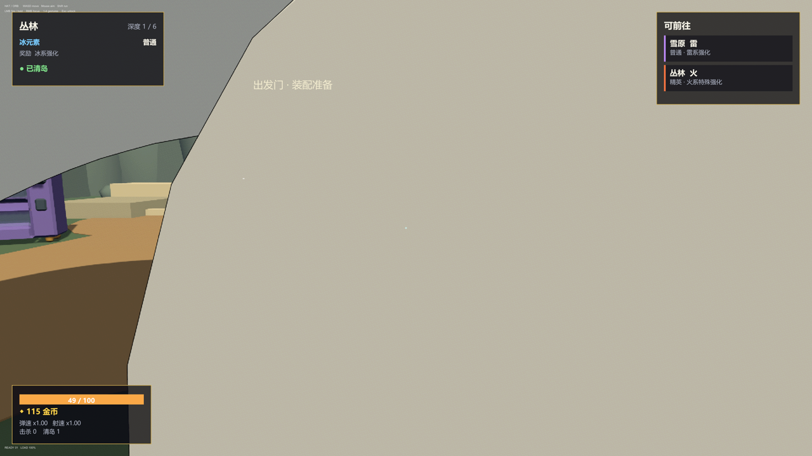
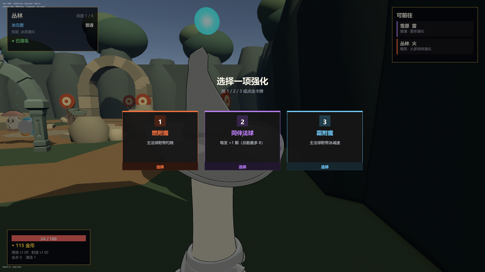

# Duck — a magic-orb shooter skeleton

Two playable Unity applications built from one lean foundation, submitted to
**Kiroween 2026** in the **Skeleton Crew** category.

A skeleton that is clear enough to read in an afternoon, flexible enough to carry
two different games, and honest about what is finished.




---

## What this is

A third-person magic-orb shooter: you fire glowing orbs out of a wizard hat, the
hat physically bulges as it charges, and the muzzle is bound to the real hat tip
so the charge visual and the shot can never disagree.

The skeleton is the combat core — locomotion, shoulder camera, orb weapon,
hat deformation, toon shading — plus the tooling that keeps two apps built from it
in sync.

## The two applications

### 1. Training Range — `apps/training-range`

The smallest honest slice. A bare court, a target dummy, and nothing else to
hide behind. This exists to answer one question: does aiming and firing feel
good before any content is added?

- Camera-relative movement (WASD), sprint (Shift), jump, slide
- Shoulder camera with smooth ADS blend and collision handling
- Orb firing with a single magazine, load/reserve state and a visible refill
- Target dummy that registers hits

```powershell
& "<UnityEditor>\Unity.exe" -projectPath apps\training-range\unity
# open Assets/DuckGame/Generated/v03/Playground.unity and press Play
```

### 2. Grove Camp — `apps/expedition`

The same combat core carrying progression, art and characters. A stylised grove
where you fight, earn and buy.

- Layered toon character with an ink outline pass and a sculpted, tailored hat
- A snail merchant with a shop UI and a coin economy fed by kills
- Forest enemies with distinct roles (charger, fleer) and hit feedback
- Atmosphere pass: canopy light, ground haze, per-biome palette

```powershell
& "<UnityEditor>\Unity.exe" -projectPath apps\expedition\unity
# open Assets/DuckGame/Maps/V12/Generated/ExpeditionHub.unity and press Play
```

Neither app needs the other. Open either one; it runs on its own.

## The foundation

`foundation/` is the canonical copy of everything both apps share:

```
foundation/Assets/DuckGame/
├── Runtime/     GooseMotor, ShoulderCamera, OrbShooter, OrbMagazine,
│                OrbProjectile, OrbConfig, OrbShotRouter, HatBulge,
│                OrbImpactPool, ExpireVisual, TargetDummy, …
├── Shaders/     GooseToon, GooseOutline, OrbGlow
└── Art/         GooseWizard_v02.fbx (21 bones, 7 actions)
```

The design rule is **content is data, not code**:

| To add… | You create | You never edit |
|---|---|---|
| a new orb type | an `OrbConfig` asset | `OrbShooter.cs` |
| a new enemy | a prefab + tuning values | `WaveController.cs` |
| a new level | a new scene | `Runtime/` |
| a new shader | a file in `foundation/Shaders` | an app-local shader |

## Why the foundation is copied, not packaged

Unity scenes bind scripts by GUID. A package that lives outside `Assets/` breaks
every scene the moment a path or version changes, which is a miserable first five
minutes for anyone cloning the repo. A small, copied skeleton is more reliable
than a clever package — the cost is drift between copies, and that cost is paid
by tooling rather than by the person trying to run the thing.

```powershell
# push foundation into both apps, refusing to overwrite app-local edits
powershell -File tools/sync-foundation.ps1

# prove neither app has drifted from the canonical foundation
powershell -File tools/check-foundation-drift.ps1
```

## Tools

| Script | What it does |
|---|---|
| `tools/sync-foundation.ps1` | Copy `foundation/` into both apps; refuses if an app copy drifted |
| `tools/check-foundation-drift.ps1` | Hash-compare every foundation file against both app copies |
| `tools/compile-check.ps1` | Headless compile gate for both apps, prints unique CS errors |
| `tools/check-kiro-tracked.ps1` | Assert `.kiro/` exists, is populated, and is not gitignored |
| `tools/check-guid-integrity.ps1` | Detect duplicate or orphaned `.meta` GUIDs |

## How Kiro was used

The `.kiro/` directory at the repo root is the working record:

- **`.kiro/steering/`** — `product.md`, `tech.md`, `structure.md`. These are why
  Kiro stops inventing a package layout or a second input system every session.
- **`.kiro/specs/`** — the feature work, as requirements → design → tasks.
- **`.kiro/hooks/`** — the automation that actually protects this repo, including
  the compile gate and the `.kiro`-must-stay-tracked check.
- **`.kiro/agents/`** — the custom agents used for the two workstreams.

See [`docs/kiro-writeup.md`](docs/kiro-writeup.md) for the full account.

## Requirements

- **Unity 2022.3.62f3c1** with URP 14 (pinned in `ProjectSettings/ProjectVersion.txt`)
- No Asset Store downloads, no private registries — a fresh clone resolves from
  the public Unity registry alone

## Licence

Project code: **MIT** (see `LICENSE`).
Third-party assets keep their own licences — see `CREDITS.md`. Each imported
asset ships its licence file beside it.
